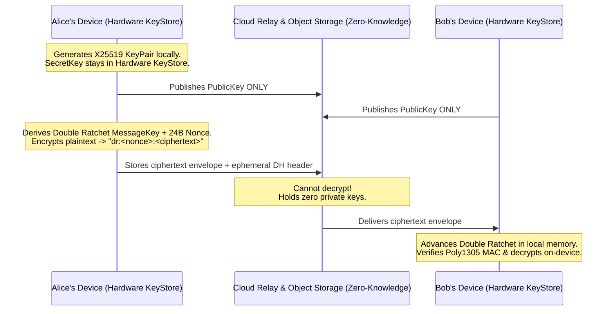

# 🛡️ ZypherChats E2EE Core (`@zypherchats/e2ee-core`)

Open-source client-side **End-to-End Encryption (E2EE)** and **Double Ratchet** cryptographic engine powering **ZypherChats**.

This repository publishes ZypherChats's core client-side cryptographic modules so security researchers, engineers, and users can independently verify that **neither ZypherChats servers, database administrators, cloud storage providers, nor network intermediaries can read messages or view encrypted media**.

---

## 🔐 Cryptographic Primitives

ZypherChats does **not** roll custom cipher algorithms. All cryptographic operations build on Daniel J. Bernstein's audited **NaCl (`tweetnacl`)** primitives paired with operating-system CSPRNG and hardware keystores:

| Layer | Primitive / Standard | Details |
| :--- | :--- | :--- |
| **Asymmetric Key Agreement** | **Curve25519 (X25519)** | 256-bit Elliptic-Curve Diffie-Hellman key exchange |
| **Session Ratcheting** | **Double Ratchet Protocol** | Ephemeral X25519 DH ratchet + SHA-512 KDF symmetric chain ratchet (`dr:` envelope) |
| **Authenticated Cipher** | **XSalsa20-Poly1305** | 256-bit stream cipher with 192-bit (24-byte) CSPRNG nonces and 128-bit Poly1305 MAC |
| **Media Encryption** | **Zero-Knowledge Binary AEAD** | Per-file random 256-bit key + 192-bit nonce (`ZYPHER_E2EE_V1:`); cloud stores ciphertext only |
| **Entropy Source (CSPRNG)** | **`expo-crypto` (`getRandomValues`)** | OS-level CSPRNG bound directly via `nacl.setPRNG` (never `Math.random()`) |
| **Private Key Storage** | **Hardware KeyStore / Keychain** | `expo-secure-store` (`WHEN_UNLOCKED_THIS_DEVICE_ONLY`) — private keys never leave the device |
| **MITM Verification** | **20-Character Safety Code + QR** | Deterministic Base36 SHA-512 public-key fingerprint (`XXXXX   XXXXX   XXXXX   XXXXX`) |

---

## 🧭 Zero-Knowledge Architecture



### Zero-Knowledge Media Flow (Photos, Videos, Voice Notes & Files)
1. Before leaving the sender's phone, raw media bytes are encrypted on-device in [`src/mediaCrypto.ts`](./src/mediaCrypto.ts) using a **fresh random 32-byte key** and **24-byte nonce** (`XSalsa20-Poly1305`).
2. Only scrambled binary bytes (`ZYPHER_E2EE_V1:<nonce><ciphertext>`) are uploaded to object storage as `application/octet-stream`.
3. The per-file decryption key (`#zk=<base64Key>`) is placed **inside** the message payload, which is itself **End-to-End Encrypted** via [`encryptMsg`](./src/e2e.ts) before touching the database.
4. Neither the database nor the object storage server ever receives the media decryption key.

---

## 📂 Repository Structure

* **[`src/secureKeyVault.ts`](./src/secureKeyVault.ts)** — Hardware-backed Android KeyStore & iOS Keychain wrapper (`WHEN_UNLOCKED_THIS_DEVICE_ONLY`).
* **[`src/crypto.ts`](./src/crypto.ts)** — CSPRNG binding, Curve25519 keypair generation, and `XSalsa20-Poly1305` authenticated encryption (`nacl.box` & `nacl.secretbox`).
* **[`src/ratchet.ts`](./src/ratchet.ts)** — Signal-inspired **Double Ratchet** state machine (`KDF_RK`, `KDF_CK`, Diffie-Hellman ratcheting, out-of-order `skippedMessageKeys` vault, and stateless recovery).
* **[`src/e2e.ts`](./src/e2e.ts)** — End-to-End message envelope (`dr:` and `e2e:`), `BoundedLRUCache`, and public-key directory interface.
* **[`src/mediaCrypto.ts`](./src/mediaCrypto.ts)** — Zero-Knowledge binary attachment encryption and MAC verification (`ZYPHER_E2EE_V1:`).
* **[`src/fingerprint.ts`](./src/fingerprint.ts)** — 20-character alphanumeric safety verification code generator for out-of-band MITM verification.
* **[`tests/verify-e2ee.mjs`](./tests/verify-e2ee.mjs)** — Standalone cryptographic verification test suite.

---

## 🧪 Verify It Yourself

Anyone with Node.js (>= 18) can run the verification suite in seconds:

```bash
git clone https://github.com/matheeshasasmin11-max/zypher-e2ee-core.git
cd zypher-e2ee-core
npm install
npm test
```

### In-App Verification for Users
1. Open any 1-on-1 chat in **ZypherChats** and tap the contact's header to open **Contact Info**.
2. Tap **Encryption** to view the **QR Code** or select **Compare a 20-digit string**.
3. Compare the 4 blocks of 5 characters (`XXXXX   XXXXX   XXXXX   XXXXX`) or scan your contact's QR code in person. Matching codes cryptographically guarantee no third party is intercepting keys.

---

## 📜 License

Released under the [MIT License](./LICENSE) for public transparency and security auditing.
