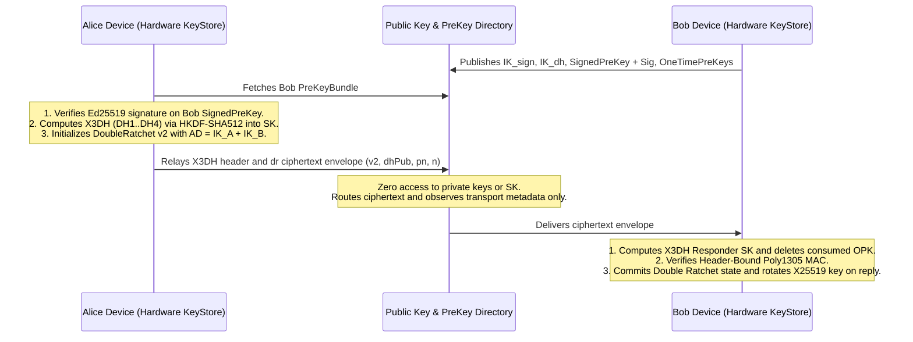

# 🛡️ ZypherChats E2EE Core (`@zypherchats/e2ee-core`)

Open-source client-side **End-to-End Encryption (E2EE)**, **X3DH PreKey Handshake**, and **Double Ratchet v2** cryptographic library used by **ZypherChats**.

This repository publishes ZypherChats's client-side cryptographic engine so security researchers, engineers, and users can inspect the exact protocol implementation, run IETF test vectors locally, and verify our cryptographic design.

> 📄 **Read our full engineering [Threat Model & Security Boundaries (`THREAT_MODEL.md`)](./THREAT_MODEL.md)** for adversary assumptions, TOFU key-directory trade-offs, metadata scope, and audit status.

---

## 🔐 Cryptographic Architecture & Standards

`@zypherchats/e2ee-core` does **not** implement custom ciphers or hashes. All primitives build atop Daniel J. Bernstein's audited **NaCl (`tweetnacl`)** library combined with standard IETF / Signal constructions:

| Layer | Standard / Construction | Implementation Details |
| :--- | :--- | :--- |
| **Initial Asynchronous Handshake** | **X3DH (`src/x3dh.ts`)** | Ed25519-signed `SignedPreKey` (`SPK`), optional single-use `OneTimePreKey` (`OPK`), 3-DH / 4-DH X25519 agreement with RFC 7748 low-order point rejection |
| **Root Key Derivation** | **RFC 5869 HKDF-SHA512 (`src/hkdf.ts`)** | Extract-and-Expand (`HKDF_SHA512`) over `rk` (salt) and ephemeral X25519 `dhOut` (IKM) |
| **Symmetric Chain Ratchet** | **RFC 2104 HMAC-SHA512 (`KDF_CK`)** | Domain-separated `HMAC(ck, 0x01)` for next Chain Key and `HMAC(ck, 0x02)` for one-time Message Key |
| **Header-Authenticated AEAD** | **XSalsa20-Poly1305 + HKDF Subkey** | 256-bit cipher + 192-bit CSPRNG nonce + 128-bit Poly1305 MAC bound to `v`, `dhPub`, `pn`, `n`, and `IK_A \|\| IK_B` associated data |
| **Downgrade & TOFU Protection** | **Strict Ratchet & Key Pinning (`src/e2e.ts`)** | Rejects un-ratcheted `e2e:` envelopes (`ProtocolDowngradeError`) and alerts on silent public-key changes (`IdentityKeyChangedError`) |
| **Media Attachment Encryption** | **Zero-Knowledge Binary AEAD (`src/mediaCrypto.ts`)** | Per-file CSPRNG 256-bit key + 192-bit nonce (`ZYPHER_E2EE_V1:`); file key travels exclusively inside `dr:` E2EE payload |
| **Entropy Source (CSPRNG)** | **OS CSPRNG (`expo-crypto` / WebCrypto)** | Fails closed if OS CSPRNG is absent — **never** falls back to `Math.random()` |
| **Private Key Vault** | **Hardware KeyStore / Keychain** | `expo-secure-store` (`WHEN_UNLOCKED_THIS_DEVICE_ONLY`) — excluded from cloud backups |
| **MITM Verification** | **20-Character Safety Code + QR** | Canonical SHA-512 Base36 public-key fingerprint (`XXXXX   XXXXX   XXXXX   XXXXX`) |

---

## 🧭 Protocol Sequence (X3DH + Double Ratchet v2)



---

## 📂 Repository Structure

* **[`src/hkdf.ts`](./src/hkdf.ts)** — RFC 2104 `HMAC-SHA512`, RFC 5869 `HKDF-SHA512` (`hkdfExtract`, `hkdfExpand`, `hkdfSha512`), constant-time comparisons, RFC 7748 zero-check, and buffer zeroization.
* **[`src/x3dh.ts`](./src/x3dh.ts)** — Extended Triple Diffie-Hellman (X3DH) asynchronous handshake with Ed25519-authenticated Signed PreKeys and One-Time PreKeys.
* **[`src/ratchet.ts`](./src/ratchet.ts)** — Signal Double Ratchet v2 engine (`KDF_RK`, `KDF_CK`, `pn` chain skipping, `MAX_SKIP = 1000` DoS cap, header-bound AEAD, and atomic post-MAC state commits).
* **[`src/e2e.ts`](./src/e2e.ts)** — High-level session manager with strict anti-downgrade pinning (`ProtocolDowngradeError`) and TOFU key-change detection (`IdentityKeyChangedError`).
* **[`src/crypto.ts`](./src/crypto.ts)** — Fail-closed OS CSPRNG binding, Curve25519 keypair helpers, and `XSalsa20-Poly1305` primitives.
* **[`src/mediaCrypto.ts`](./src/mediaCrypto.ts)** — Zero-Knowledge binary attachment encryption (`ZYPHER_E2EE_V1:`).
* **[`src/secureKeyVault.ts`](./src/secureKeyVault.ts)** — Hardware-backed Android KeyStore & iOS Keychain adapter (`WHEN_UNLOCKED_THIS_DEVICE_ONLY`).
* **[`src/fingerprint.ts`](./src/fingerprint.ts)** — 20-character safety verification code generator for out-of-band MITM verification.
* **[`tests/verify-e2ee.mjs`](./tests/verify-e2ee.mjs)** — Automated test suite executing compiled `src/` modules against IETF RFC 4231 / RFC 5869 test vectors and adversarial attack scenarios.
* **[`THREAT_MODEL.md`](./THREAT_MODEL.md)** — Detailed threat model, metadata disclosure, TOFU assumptions, and audit status.

---

## 🧪 Run the Cryptographic Test Suite & RFC Vectors

Anyone with Node.js (`>= 18`) can compile the TypeScript sources and run the full verification suite locally:

```bash
git clone https://github.com/matheeshasasmin11-max/zypher-e2ee-core.git
cd zypher-e2ee-core
npm install
npm test
```

The suite compiles `src/*.ts` and verifies:
1. **IETF RFC 4231 Official Test Vectors** for `HMAC-SHA512` (including keys exceeding the 128-byte SHA-512 block size).
2. **RFC 5869 `HKDF-SHA512` Differential Verification** byte-for-byte against OpenSSL (`node:crypto.hkdfSync`).
3. **X3DH PreKey Handshake** (4-DH with OPK, 3-DH without OPK, and active MITM forged Ed25519 signature rejection).
4. **Double Ratchet v2 Multi-Turn & Out-of-Order Delivery** across interleaved DH ratchets (`pn` and `n` skipping) + single-use deletion of consumed keys.
5. **Header-Authenticated AEAD & Atomic State Protection** (verifies tampering with `n`, `pn`, `dhPub`, or ciphertext fails Poly1305 MAC without corrupting or advancing session state, plus `MAX_SKIP` DoS rejection).
6. **Protocol Downgrade & TOFU Key-Substitution Defense** (`ProtocolDowngradeError` when forcing `e2e:` on a `dr:` session, and `IdentityKeyChangedError` on silent directory key swaps).
7. **Zero-Knowledge Binary Media AEAD (`ZYPHER_E2EE_V1:`)** encryption and tamper rejection.

---

## 🗺️ Security Roadmap

- [x] TweetNaCl Curve25519 + XSalsa20-Poly1305 + OS CSPRNG hardware-backed vault
- [x] RFC 5869 `HKDF-SHA512` & RFC 2104 `HMAC-SHA512` Double Ratchet v2
- [x] Header-authenticated AEAD, `MAX_SKIP` DoS bounds, and atomic post-MAC state transitions
- [x] Strict `dr:` anti-downgrade pinning & TOFU key-change alerts
- [x] X3DH asynchronous prekey handshake (`src/x3dh.ts`)
- [x] Public Threat Model (`THREAT_MODEL.md`) & RFC 4231 / RFC 5869 test vectors
- [ ] Sender Keys / MLS-style ratcheted Forward Secrecy for large group chats
- [ ] Key Transparency log (append-only Merkle tree for public-key directory auditing)
- [ ] Independent third-party cryptographic security audit

---

## ⚠️ Audit Notice

While `tweetnacl` is an extensively audited cryptographic library, the protocol composition in `@zypherchats/e2ee-core` has **not yet undergone a formal paid third-party security audit**. Community code review, issue reports, and vulnerability disclosures are warmly welcomed.

## 📜 License

Released under the [MIT License](./LICENSE).
